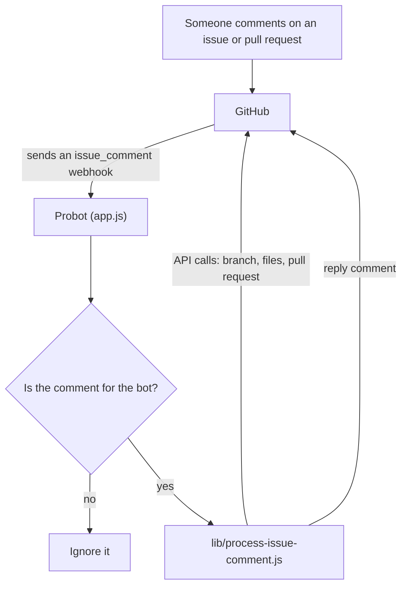

# Bot Architecture

This page walks you through what happens when someone asks the bot to add a
contributor, and where that code lives. Read it before you change the bot
logic.

To set up your environment and run the tests, see
[DEVELOPMENT.md](../DEVELOPMENT.md). If you haven't run the bot yet, start
with [Run the bot locally](run-bot-locally.md). It explains the three
pieces you'll see here: the GitHub App, the bot, and webhooks.

## The big picture

The bot is a [Probot](https://probot.github.io/) app. Probot is a Node.js
framework for building GitHub Apps. It runs a web server, checks that each
webhook really came from GitHub, sends each event to the right handler, and
logs in to GitHub as the app.

Traffic goes in two directions:

* **GitHub to the bot:** GitHub sends a webhook when someone comments. The
  bot checks it with the webhook secret.
* **The bot to GitHub:** the bot calls the GitHub API to read files, open a
  pull request, and reply. It logs in with the app's private key.

## What happens when someone comments

1. Someone comments on an issue, or on the conversation tab of a pull
   request, in a repository where the app is installed.
2. GitHub sends an `issue_comment` webhook to the bot.
3. [`app.js`](../app.js) handles the `issue_comment.created` event. It
   skips the comment if either check fails:
   * [`lib/is-message-by-app.js`](../lib/is-message-by-app.js): the comment
     was written by the bot itself (`allcontributors[bot]`).
   * [`lib/is-message-for-app.js`](../lib/is-message-for-app.js): the
     comment doesn't mention `@all-contributors` or `@allcontributors`.
4. [`lib/process-issue-comment.js`](../lib/process-issue-comment.js) takes
   over. It calls [`lib/parse-comment.js`](../lib/parse-comment.js) to work
   out the action, the usernames, and the contribution types. Parsing uses
   the [compromise](https://github.com/spencermountain/compromise) natural
   language library. Right now `add` is the only action.
5. For each contributor, the bot:
   * Sets up the repository and picks a branch named
     `all-contributors/add-<username>`. If that branch already has an open
     pull request, the bot adds to it
     ([`lib/setup-repository.js`](../lib/setup-repository.js)).
   * Reads `.all-contributorsrc`, or creates a new one if the repository
     doesn't have it yet ([`lib/get-config.js`](../lib/get-config.js)).
   * Looks up the user's GitHub profile, updates the config, regenerates
     the contributors table in each file listed in the config, and opens
     or updates the pull request
     ([`lib/add-contributor.js`](../lib/add-contributor.js)).
6. The bot posts one reply comment with the result, such as a link to the
   pull request or an error message.

`app.js` also listens for the `installation` and
`installation_repositories` events. It only logs them.

### Which comments reach the bot

The app subscribes to one event, `issue_comment`, in [`app.yml`](../app.yml).
GitHub can't filter webhooks by comment text, so every new comment in every
repository where the app is installed is sent to the bot. The checks in
step 3 throw most of them away.

Inline code review comments on a pull request are a different event, so the
bot never sees them.

## Where the code lives

### Entry points

* [`app.js`](../app.js): the Probot app. It registers the event handlers.
  `npm start` runs it locally with `probot run ./app.js`.
* [`api/github/webhooks.js`](../api/github/webhooks.js): the production
  entry point on Vercel. It wraps `app.js` and receives webhooks at
  `/api/github/webhooks`.

IMPORTANT: We currently do not have access to the bot Vercel deployment bu we are working on that. We can however all test the bot locally.

### Comment handling in `lib/`

* `is-message-by-app.js` and `is-message-for-app.js`: decide whether to
  handle a comment.
* `process-issue-comment.js`: the root of comment handling.
* `parse-comment.js`: works out what the comment asks for.
* `setup-repository.js`: picks the branch to work from.
* `get-config.js`: loads or creates `.all-contributorsrc`.
* `add-contributor.js`: adds one contributor and opens the pull request.
* `get-user-details.js`: fetches a user's GitHub profile.
* `to-safe-git-reference-name.js`: turns a username into a safe branch
  name.

### Building blocks in `lib/modules/`

* `comment-reply.js`: `CommentReply` collects reply messages and posts
  them as one comment at the end.
* `repository.js`: `Repository` wraps the GitHub API calls for reading and
  updating files, creating branches, and opening pull requests.
* `config.js`: `Config` reads and updates `.all-contributorsrc`.
* `content-files.js`: `ContentFiles` regenerates the contributors table in
  files such as `README.md`. It uses
  [all-contributors-cli](https://github.com/all-contributors/cli) to
  build the table.
* `helpers.js`: builds pull request titles, bodies, and profile links.
* `errors.js`: error classes. Errors that extend `AllContributorBotError`
  are expected problems, such as an unknown user. The bot posts their
  message as a reply. Any other error gets a generic "We had trouble
  processing your request" reply.

## Learn more

* [Probot docs](https://probot.github.io/docs/)
* [Octokit REST API docs](https://octokit.github.io/rest.js/), the GitHub
  API client that Probot provides as `context.octokit`
* [Bot usage docs](https://allcontributors.org/docs/en/bot/usage), for
  what users can type in a comment
