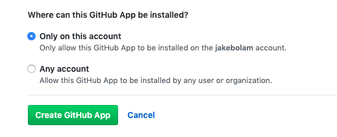
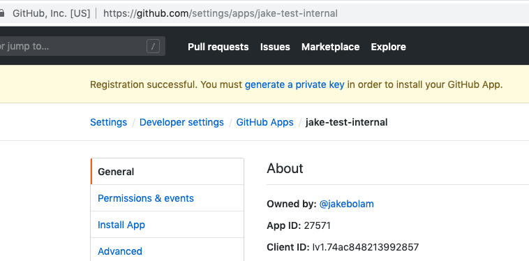
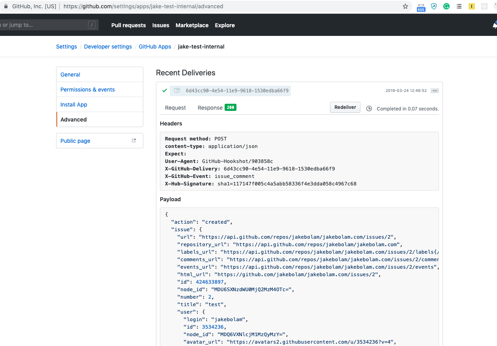

# Local bot setup

> [!IMPORTANT]
> Uninstall the production bot from your user account before you continue.
> Otherwise, multiple bots will respond to your comments.

To run the bot on your computer, you create a GitHub App, connect this
repository to that app, and try it on a test repository.

## Key terms

Three terms will help you understand how the pieces fit together:

* **GitHub App:** The app you create in your GitHub settings. It holds the
  bot's permissions, the webhook address, and the private key.
* **Bot:** The Node.js program in this repository. You start it with
  `npm start`. When GitHub sends the bot a webhook, the bot uses the GitHub
  App's credentials to reply. GitHub shows that reply as a comment from a
  bot user.
* **Webhook:** A message GitHub sends when something happens, such as a new
  comment. The bot reads the message and decides whether to reply.

## Before you start

You need:

* A GitHub account
* [Node.js](https://nodejs.org/) and npm installed
* This repository cloned to your computer

## 1. Create a GitHub App for testing

1. Go to your GitHub
   [developer settings](https://github.com/settings/developers).
2. Create a [new GitHub App](https://github.com/settings/apps/new).
3. Fill in the required fields:
   * **GitHub App name:** Any name you like. It must be unique across GitHub.
   * **Homepage URL:** Anything.
   * **Webhook URL:** Anything. You can change it later if you use smee.io.
4. Fill in these important fields:
   * **Webhook secret:** Enter `development`.
   * **Permissions:** Match
     [app.yml](https://github.com/all-contributors/all-contributors-bot/blob/main/app.yml#L54).
     * Set **Read & write** for **Contents**, **Issues**, and
       **Pull requests**.
     * Set **Read-only** for **Metadata**.
   * **Subscribe to events:** Match
     [app.yml](https://github.com/all-contributors/all-contributors-bot/blob/main/app.yml#L15).
     Check **Issue comment**.
     Pull request comments arrive as issue comments, so you don't need to
     subscribe to a separate pull request comment event.
   * **Where can this GitHub App be installed?:** Select
     **Only on this account**.

   

5. Click **Create GitHub App**.

## 2. Configure your GitHub App

After you create the app, you see its settings page.



1. In the left sidebar, click **General**. Scroll to **Private keys** and
   click **Generate a private key**. GitHub downloads a `.pem` file.
2. Rename the file to `allcontributorsbot.pem`.
3. Store the file somewhere secure. GitHub keeps only the public half of the
   key. If you lose this file, you must generate a new key.
   See [Managing private keys for GitHub Apps](https://docs.github.com/en/apps/creating-github-apps/authenticating-with-a-github-app/managing-private-keys-for-github-apps).
4. In the left sidebar, click **Install App**. Install the app on your user
   account.

> [!NOTE]
> If the app already has a key and you still have its `.pem` file, use that
> file and skip generating a new key.
> GitHub does not let you delete the only key on an app. If you lost the old
> `.pem` file, generate a new key first, then delete the old one.

## 3. Configure the bot to connect to your GitHub App

1. In the root of your cloned repository (next to `package.json`), create a
   file named `.env`.
2. Add this template to the file:

   ```text
   APP_ID=
   WEBHOOK_SECRET=development
   PRIVATE_KEY=
   ```

3. Fill in the values:
   * `APP_ID`: Find this on the **General** tab of your app's settings, under
     **About**.
   * `WEBHOOK_SECRET`: Leave it as `development`. This matches the secret you
     set in step 1.
   * `PRIVATE_KEY`: Use the contents of your `.pem` file, converted to a
     single line of text. See the next step.
4. Convert the private key to a single line. In your terminal, go to the
   folder that contains `allcontributorsbot.pem` (often your `Downloads`
   folder), then run:

   ```bash
   openssl base64 < allcontributorsbot.pem | tr -d '\n' | pbcopy
   ```

   This command copies the encoded key to your clipboard as one line.
   `pbcopy` works on macOS only. On other systems, remove `| pbcopy`, run
   the command, and copy the text it prints.
5. Paste the copied text after `PRIVATE_KEY=` in your `.env` file.

## 4. Set up a test repository

1. Create a repository under the GitHub account where you installed the app.
2. Make sure issues and pull requests are enabled in that repository.
3. Make sure the repository has atleast a single commit and a README.md file in it to accept a new contributor.
4. Create a new issue in the repository.
5. Comment on the issue with the text below. Replace `@yourusername` with your
   own username.

   ```text
   @all-contributors please add @yourusername for design
   ```

> [!NOTE]
> Your app might have a different name, such as `all-contributors-bot` or
> `all-contributors-lwasser`. You still use `@all-contributors` in comments.

Your app receives this comment, but your bot is not running yet, so it can't
reply. In the next step, you confirm that GitHub received the comment.

## 5. Check that GitHub received your comment

1. Go to your [app settings](https://github.com/settings/apps/).
2. Click your app, then click the **Advanced** tab.
3. Under **Recent Deliveries**, click the most recent delivery to see its
   details.

   

4. Copy the entire **Payload** section. Paste it into a new file named
   `test-webhook-payload.json` and save it.
5. Copy the values in the **Headers** section. You need them in step 6.

## 6. Send your first webhook

A webhook is a request GitHub sends to the bot when something happens in a
repository. In this case, the event is a new comment on an issue. GitHub
can't reach a bot running on your computer, so you send a copy of the webhook
yourself.

1. Install the bot's dependencies:

   ```bash
   npm install
   ```

2. Start the bot:

   ```bash
   npm start
   ```

   You should see output like this:

   ```text
   > all-contributors-bot@0.0.0-development start
   > probot run ./app.js

   WARNING :: Using the all-contributors node-api comes with zero guarantees of stability and may contain breaking changes without warning
   INFO (server): Running Probot v12.2.8 (Node.js: v22.22.0)
   INFO (server): Listening on http://localhost:3000
   ```

3. Open a second terminal window. Send the webhook to the bot with `curl`,
   or use a tool like Postman. You send the headers from step 5 and the
   contents of `test-webhook-payload.json`.

   With `curl`, the command looks like this. Replace the header values with
   the ones from your delivery:

   ```bash
   curl -vX POST http://localhost:3000/ -d @test-webhook-payload.json \
   --header "Content-Type: application/json" \
   --header "User-Agent: GitHub-Hookshot/4d63832" \
   --header "X-GitHub-Delivery: 413857f0-8b61-11eb-92be-566b7aa5f6ee" \
   --header "X-GitHub-Event: issue_comment" \
   --header "X-GitHub-Hook-ID: 297478976" \
   --header "X-GitHub-Hook-Installation-Target-ID: 105785" \
   --header "X-GitHub-Hook-Installation-Target-Type: integration" \
   --header "X-Hub-Signature: sha1=ed222e6750dc2954a422ed8dd371f9da66368104" \
   --header "X-Hub-Signature-256: sha256=04d0943f20545ac8df974466c502e4b9743d3618149b03f4ea1a9e658bf31fd0"
   ```

4. Check the terminal where `npm start` is running. Look for errors.
5. Check your test issue on GitHub. If the bot replied, you have run the bot
   locally and it is responding to webhooks. 🎉
6. If the bot did not reply, or left an error message, read the output in
   the `npm start` terminal and troubleshoot.

## Alternative: use smee.io to receive webhooks

Instead of sending a copy of the webhook with `curl`, you can have GitHub
send webhooks straight to your computer using [smee.io](https://smee.io/).

1. Create a channel on smee.io and copy its URL.
2. Add this line to your `.env` file:

   ```text
   WEBHOOK_PROXY_URL=<your smee.io channel URL>
   ```

3. In your GitHub App settings, set the **Webhook URL** to the same smee.io
   channel URL.
4. Restart the bot with `npm start`.

The bot now responds to new comments as they arrive.
